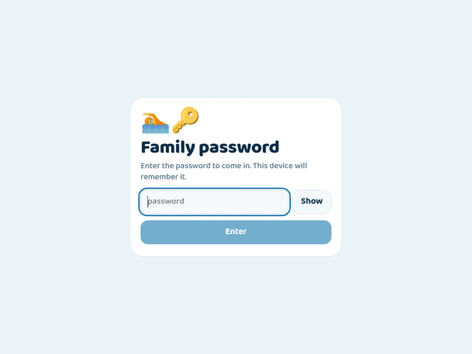
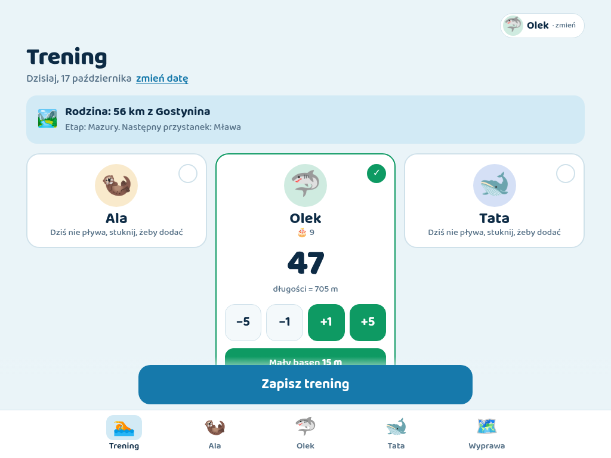
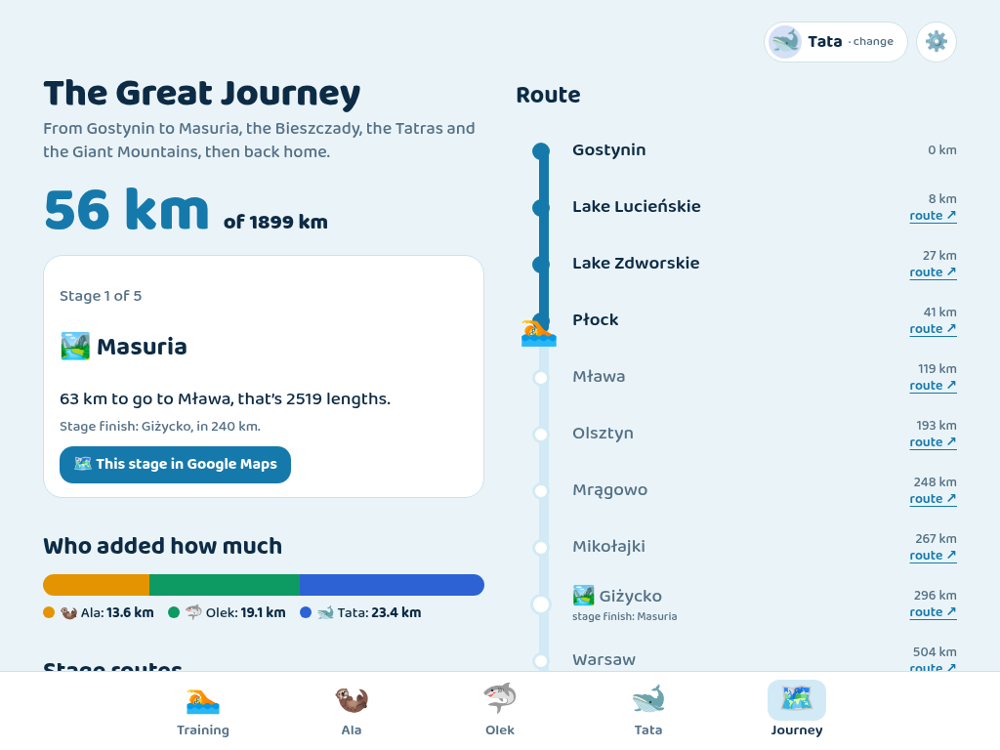
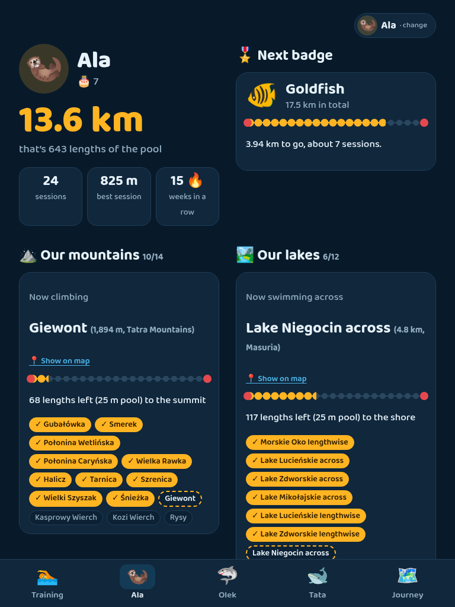
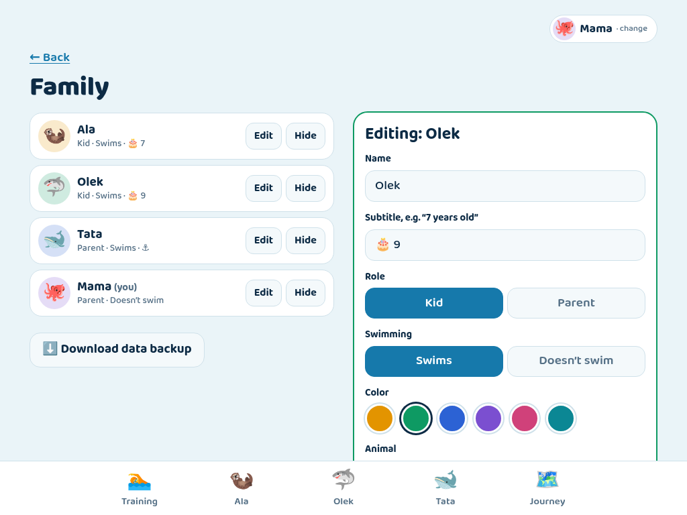
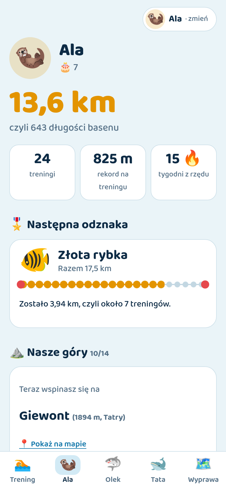
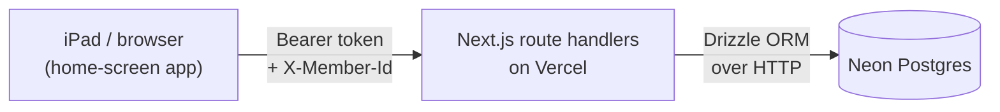

# 🏊 Pływackie wyprawy · Swim Adventures

[](https://github.com/novirael/fun-pool-workouts-dashboard/actions/workflows/ci.yml)
[](LICENSE)

A family swim log for kids, built for the iPads they carry to the pool. After each training they log their lengths, and the meters add up to climbing Polish mountains, crossing lakes and earning badges. The whole family's meters also move everyone along a road trip around Poland.



<sub>The walkthrough uses a made-up demo family. The UI picks Polish or English from the device language.</sub>

## Features

- **Quick logging.** Tap who swam, adjust lengths with −5/−1/+1/+5, pick the 15 m or 25 m pool, then save. Each device remembers who is using it and opens with that person's card already on.
- **A celebration after every save.** Each swimmer gets a fun fact ("That's 3.6 times the length of a football pitch!"), plus any new records, peaks reached, lakes crossed and badges earned.
- **Personal progress:**
  - Mountains in three stages: our Polish favourites, then the [Crown of Polish Mountains](https://en.wikipedia.org/wiki/Crown_of_Polish_Mountains), then the Seven Summits.
  - Lakes from Morskie Oko to the English Channel.
  - Weekly streaks and personal records.
- **25 badges**, spaced by each swimmer's own monthly goal so a 7-year-old and an adult both earn about one a month. A parent marks each badge as handed out once they give the real one.
- **The Great Journey.** Everyone's meters move the family along a 1,899 km trip: the Masurian lakes, the Bieszczady, the Tatras, the Giant Mountains, and back home. Every stage links to its route in Google Maps.
- **Family settings in the app.** Add swimmers and non-swimmers, set roles (parent or kid), colors, animals and goals. Each entry shows who added it.
- **Made for iPads.** Layouts for tablet and phone, light and dark mode, and it can be added to the home screen. Polish and English.
- **No accounts.** One shared family password, remembered on each device.

## Screenshots

| Training (Polish, iPad) | Family journey |
| --- | --- |
|  |  |
| **Profile (dark mode, iPad portrait)** | **Family settings (parents only)** |
|  |  |

<p align="center"></p>

## How it works



- **The browser does the work.** The client loads the family's data with a single `GET /api/state` and computes all statistics in the browser: streaks, badges, ladders and the route position. The domain logic in `lib/domain/` is pure TypeScript with unit tests.
- **Retries can't duplicate.** Writes are single SQL statements, and each training's id is generated on the device, so retrying a save on flaky pool Wi-Fi can't create duplicates.
- **No polling.** The app refreshes when it comes back to the foreground. An iPad left open doesn't keep the auto-suspending free-tier database awake, and the app reloads itself after a new deploy.
- **Safe migrations.** Migrations are generated with drizzle-kit and run in a transaction after a successful production build.

**Stack:** Next.js 16 (App Router), React 19, TypeScript, TanStack Query, zod, Drizzle ORM, Neon Postgres, Vitest, PGlite for local development and tests.

## Run it locally

```bash
npm ci
cp .env.example .env.local   # set APP_PASSWORD and AUTH_SECRET
npm run dev                  # http://localhost:3000
```

No database setup is needed. Without `DATABASE_URL`, the app uses an embedded Postgres (PGlite) stored in `.data/`; delete that folder to start over. On first run the app asks you to add yourself as a parent.

```bash
npm run check                # typecheck + lint + tests
npm run db:generate          # after changing lib/server/schema.ts: writes a new SQL migration
```

## Deploy your own

1. Fork this repository and import it in [Vercel](https://vercel.com/new).
2. In the project, go to **Storage → Create Database → Neon** and connect it to the **Production** environment. This adds `DATABASE_URL` and `DATABASE_URL_UNPOOLED`.
3. Add these environment variables (Production, and Preview if you use it):
   - `APP_PASSWORD`: the family password.
   - `AUTH_SECRET`: a random string, e.g. from `openssl rand -base64 32`.
4. Deploy. The build runs `next build` and then applies database migrations. It fails on purpose if no database is connected.
5. Optional, but recommended because the password is the only lock: add a **Firewall → Rate limit** rule for `POST /api/auth`, for example 10 requests per 10 minutes per IP.

To change the password later, edit `APP_PASSWORD` and redeploy. Every device will ask for the new one.

### On the iPads

Open the site in Safari, then tap **Share → Add to Home Screen**. Use the app from that icon: Safari clears a website's storage after about a week without a visit, but home-screen apps keep it. Enter the password once and pick who uses the iPad.

## Make it yours

Everything family-specific is entered in the app. The adventure content lives in a few plain files:

| What | Where |
| --- | --- |
| Road trip: start town, stops, stages | `lib/domain/route.ts` |
| Mountains and lakes | `lib/domain/places.ts` |
| Badges and how they're earned | `lib/domain/badges.ts` |
| Fun comparisons | `lib/domain/compare.ts` |
| All texts (Polish and English) | `lib/i18n/pl.ts`, `lib/i18n/en.ts` |

The English dictionary is type-checked against the Polish one, so a missing translation fails `npm run typecheck`.

## Security and privacy

This is a family app, and the protection is sized for that:

- **The data is behind the shared password, the page is not.**
  - One shared password protects all data.
  - Devices store a token (`HMAC(AUTH_SECRET, password)`), not the password itself.
  - Changing either variable signs out every device.
  - The page itself is public and contains no family data. Names and history load only after login.
- **Roles are an honor system.** Parents manage the family, mark badges and can delete any entry. Kids can log for anyone but only delete their own entries. Everyone shares the password, so a child could pick a parent's profile: this prevents accidents, not determined kids.
- **Defaults:** the site is set to `noindex` and can't be framed, API responses are `no-store`, failed logins are delayed, and input is validated on the server with zod.
- **Backup:** parents can download a JSON copy of everything in **⚙️ Family → Download data backup**.

## Tests

`npm test` runs:

- **Unit tests** for the domain logic. The badge timeline is checked against the original algorithm, and route distances are pinned.
- **Plural and formatting checks** for both languages.
- **API tests** that call the real route handlers against an in-memory Postgres with the real migrations. They cover auth, roles, validation, idempotent saves and the last-parent guard.

CI runs typecheck, lint and tests on every push.

## Project structure

```
app/            pages, API route handlers (app/api/*), manifest, icons
components/     client UI (the app renders in the browser)
lib/domain/     pure logic: stats, streaks, badges, ladders, route
lib/i18n/       Polish/English dictionaries, locale detection, formatting
lib/server/     database, schema, auth, request handling
lib/client/     API client, queries/mutations, local storage
drizzle/        SQL migrations
tests/          API tests against PGlite
```

## License

[MIT](LICENSE)
